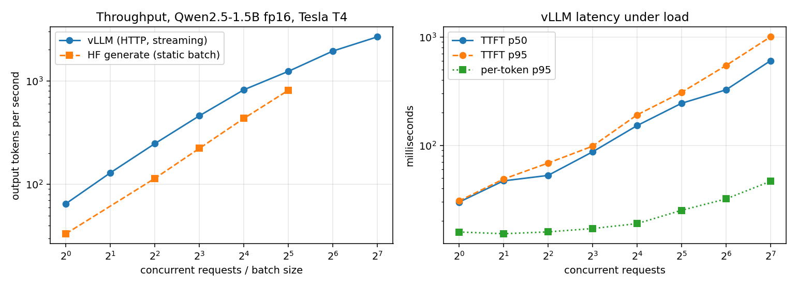
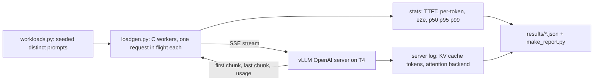
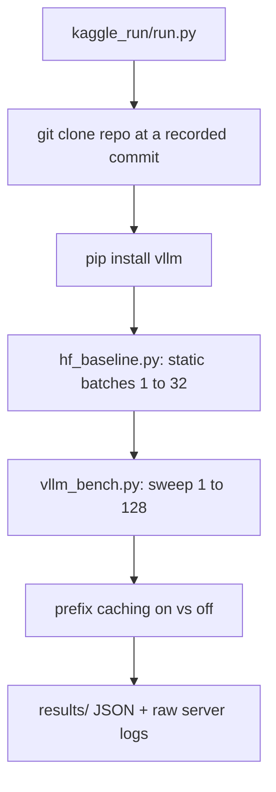

# llm-serving-lab

**Hands-on LLM serving measurements: vLLM against plain Hugging Face `generate()` on a Tesla T4, with time to first token, per-token latency, throughput, prefix caching, KV cache sizing and a tokenizer cost study. Every number comes from a run you can open.**

[Public Kaggle run (logs and outputs)](https://www.kaggle.com/code/adarshcod/llm-serving-lab-t4) | [Results table](results/results.md) | [Raw JSON](results/) | Keywords: `vllm` `llm-inference` `paged-attention` `continuous-batching` `prefix-caching` `kv-cache` `tokenization` `benchmarking`



## What it found

Model: Qwen2.5-1.5B-Instruct, fp16, one Tesla T4 (15 GB), vLLM 0.34.0, 128 output tokens per request, 1,040 requests in the sweep, 0 failed.

| Concurrency | vLLM out tok/s | TTFT p50 | TTFT p95 | per-token p95 | HF `generate` tok/s (same batch) | vLLM / HF |
|---:|---:|---:|---:|---:|---:|---:|
| 1 | 65.0 | 30 ms | 31 ms | 15.9 ms | 33.3 | 1.95x |
| 4 | 247.6 | 53 ms | 69 ms | 15.9 ms | 114.3 | 2.17x |
| 8 | 459.6 | 87 ms | 98 ms | 17.1 ms | 222.6 | 2.06x |
| 16 | 820.2 | 152 ms | 191 ms | 19.0 ms | 433.9 | 1.89x |
| 32 | 1,235.5 | 244 ms | 308 ms | 25.2 ms | 811.0 | 1.52x |
| 64 | 1,940.3 | 325 ms | 545 ms | 32.0 ms | not run | n/a |
| 128 | 2,660.4 | 604 ms | 1,002 ms | 46.6 ms | not run | n/a |

- **Throughput scales 41x** from one request to 128 (65 to 2,660 tokens/s) while p95 per-token latency goes from 16 ms to 47 ms. That is continuous batching: the GPU does more useful work per step as requests pile in.
- **Prefix caching:** with a 1,140-token shared prompt at concurrency 4, p50 time to first token fell from **984 ms to 138 ms (7.1x)**, p95 from 1,383 ms to 150 ms.
- **KV cache cost is computable.** From the model config alone: 28 layers x 2 KV heads x 128 head dim x 2 (K and V) x 2 bytes = **28,672 bytes per token**, 6x less than without grouped-query attention. vLLM's own log reported 325,632 tokens in 8.70 GiB, and 325,632 x 28,672 bytes = 8.695 GiB. A test pins this (`tests/test_loadgen.py`).
- **Tokenizers price text differently.** The same Hindi paragraph is 235 tokens on Qwen2.5, 132 on Llama 3.2, 254 on GPT-4's cl100k and 80 on GPT-4o's o200k. The English one is 61 on all four. More tokens means more KV cache, more decode steps and a larger bill ([`results/tokenization.json`](results/tokenization.json)).
- **Attention backend on a T4:** vLLM chose `TRITON_ATTN` (no FlashAttention 2 on compute capability 7.5), so fp16 only and no bf16.

## What this does not show

- The Hugging Face numbers are an offline batch (no HTTP, no streaming, no queueing) with all 128 tokens generated for every row. That is the best case for static batching. The gap would be larger with mixed output lengths, where a static batch waits for its longest member. That experiment is not in this repo yet.
- One small model on one GPU generation. Do not read the ratios as general vLLM speed-ups.
- The first request after each server start is slower because of a Triton JIT compile (vLLM warns about it in the log). Those cold times are excluded from every table above.
- Prefix caching was tested on a synthetic shared prompt. Real gains depend on how much of your traffic really shares a prefix.

## How it works



The load generator is closed-loop: concurrency stays at exactly C for the whole run, which is how a throughput and latency curve is meant to be read. It times the first streamed content chunk (TTFT), derives per-token time from the server's reported token count, and records every failure instead of hiding it. It is checked against a fake server with a known 50 ms first-token and 10 ms per-token speed (`tests/test_loadgen.py`), so a wrong measurement would fail a test before it reached a table.



## Reproduce

The Kaggle run used commit `3628283` (recorded in [`results/raw/COMMIT_used_on_kaggle.txt`](results/raw/COMMIT_used_on_kaggle.txt)). To rerun on any GPU with 8 GB or more:

```bash
git clone https://github.com/adarshcod30/llm-serving-lab && cd llm-serving-lab
pip install -e ".[dev]" vllm
python scripts/hf_baseline.py --model Qwen/Qwen2.5-1.5B-Instruct      # needs the GPU to itself
python scripts/vllm_bench.py  --model Qwen/Qwen2.5-1.5B-Instruct      # starts and stops its own server
python scripts/make_report.py                                         # tables and charts from the JSON
python -m servelab.tokens results/tokenization.json                   # runs on a laptop, no GPU
pytest -q                                                             # 6 tests, no GPU
```

On a Kaggle T4, `kaggle kernels push -p kaggle_run --accelerator NvidiaTeslaT4` runs the whole thing.

## Project structure

```
servelab/        loadgen.py (streaming load generator), server.py (vLLM launcher + log facts),
                 kvmath.py (KV cache arithmetic), tokens.py + corpus.py (tokenizer study), stats.py, workloads.py, env.py
scripts/         hf_baseline.py, vllm_bench.py, make_report.py
kaggle_run/      Kaggle GPU driver and metadata
kaggle_probe/    the first check that vLLM installs and serves on a T4
results/         JSON results, results.md, raw vLLM server logs
tests/           load generator vs a fake server of known speed, percentile and KV math tests
```

## Stack

Python 3.13, vLLM 0.34.0, PyTorch 2.14, Transformers 5.20, aiohttp, tiktoken, matplotlib, pytest. Run on Kaggle (free Tesla T4).

## Roadmap

- Mixed output lengths, to measure what continuous batching really buys over static batches.
- An AWQ 4-bit variant: memory, throughput and quality side by side.
- Put [CacheLLM](https://github.com/adarshcod30/CacheLLM) in front of the vLLM endpoint and measure hit versus miss latency.
- A larger model on a bigger GPU to see where the ratios move.

## Contributing and license

Issues and pull requests are welcome. MIT licensed (see `LICENSE`).

## Contact

Adarsh Dwivedi, [GitHub](https://github.com/adarshcod30), [LinkedIn](https://www.linkedin.com/in/adarshdwivedi30).
